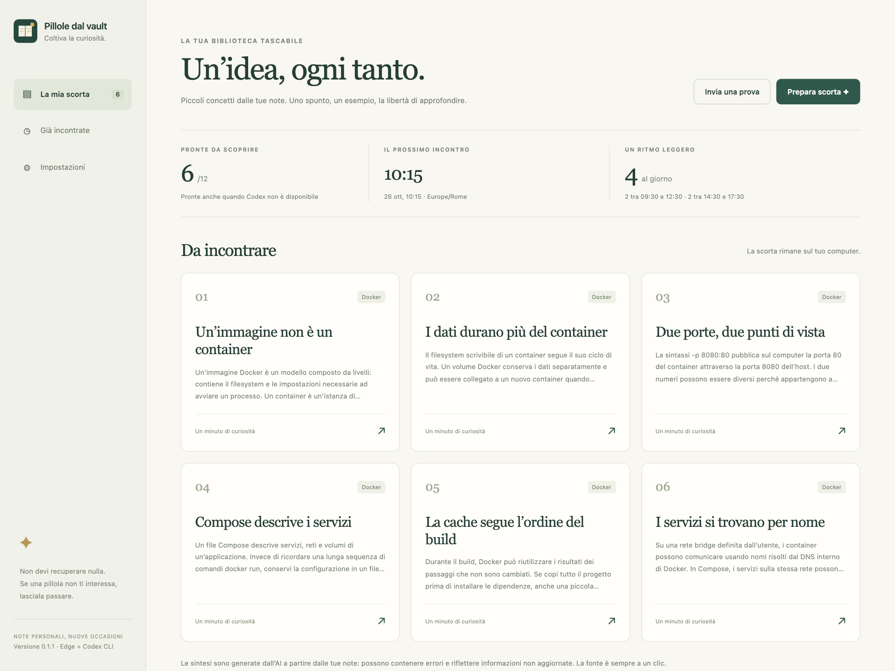
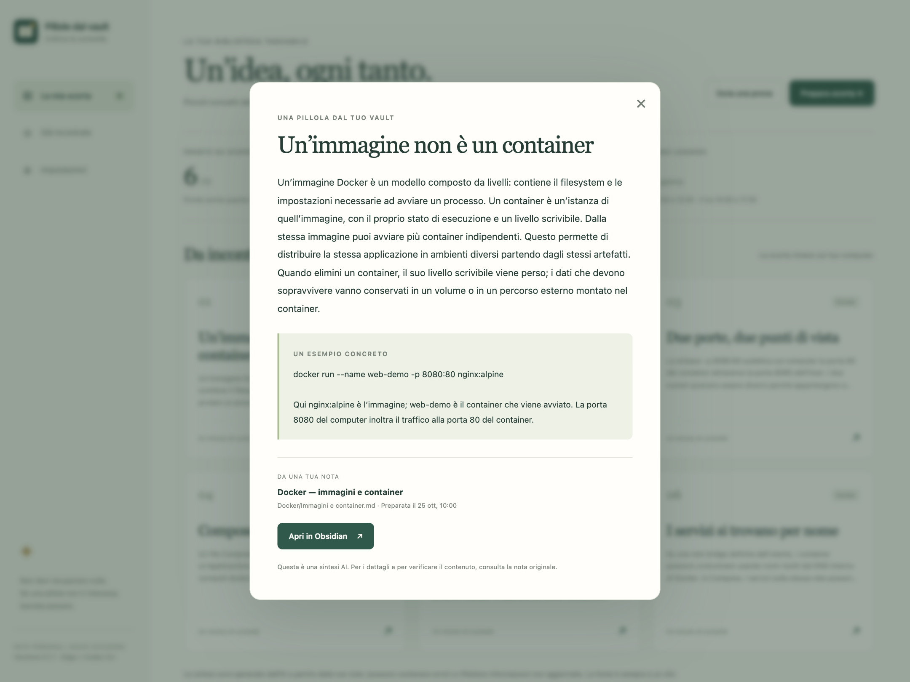
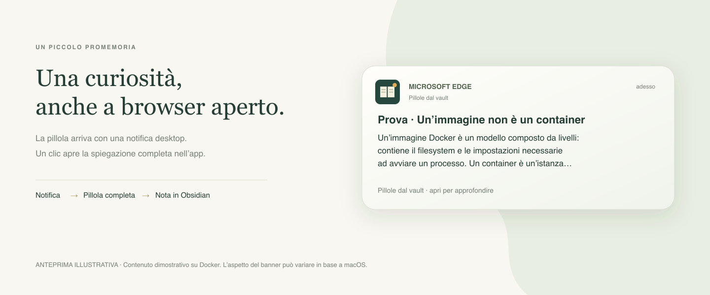

# Pillole dal vault

Estensione personale per **Microsoft Edge su macOS** che ripropone brevi concetti dalle note di un vault Obsidian. Genera una scorta tramite Codex CLI, mostra notifiche desktop e permette di aprire la nota originale.

> **Versione sperimentale 0.1.1.** La prima implementazione è disponibile, ma i test applicativi e il flusso reale non sono ancora stati eseguiti. Una revisione statica ha identificato cinque problemi ancora aperti: leggere [KNOWN_ISSUES.md](KNOWN_ISSUES.md) prima dell'uso.

## Anteprima

Schermate dell'interfaccia dell'app con contenuti e orari dimostrativi su **Docker**. Non contengono note del vault personale.

### La scorta

Una raccolta di concetti pronti da leggere: immagini e container, volumi, porte, Compose, build cache e reti.



### Una pillola nel dettaglio

Spiegazione del concetto, esempio concreto e collegamento alla nota di origine in Obsidian.



### La notifica desktop

**Anteprima illustrativa**, non una cattura del banner nativo di macOS. Mostra un contenuto dimostrativo su Docker e i campi inviati dall’estensione; impaginazione, icone e testo visibile possono variare in base al sistema. Un clic sulla notifica apre la pillola completa nell’app, da cui si può raggiungere la fonte in Obsidian. Le notifiche di Microsoft Edge devono essere abilitate nelle impostazioni di macOS.



## Funzionamento

- Quattro pillole nei feriali: due tra **09:30–12:30** e due tra **14:30–17:30**, fuso **Europe/Rome**.
- Orari casuali distribuiti nelle fasce, con persistenza tra i riavvii e senza recupero degli invii scaduti.
- Scorta locale obiettivo di **12 pillole**, rifornita quando ne restano **4**; batch massimo di quattro note.
- Invii automatici inizialmente **disabilitati**. La prova manuale funziona anche la sera e nel weekend, senza consumare scorta o quote.
- Lettura delle note, esempio, fonte e apertura in Obsidian; storico locale delle pillole inviate.
- Template, MOC, file nascosti e symlink esclusi. Cartelle escluse, fasce, quantità e fuso configurabili.

## Requisiti

- macOS e Microsoft Edge basato su Chromium 120 o successivo.
- Python **3.9+** e **Codex CLI** già disponibili, con autenticazione configurata.
- Obsidian e un vault Markdown leggibile.
- Node **18+** è facoltativo e serve solo per eseguire i test JavaScript.

L'app usa JavaScript nativo e la libreria standard Python: non richiede build, librerie npm o un server HTTP.

## Installazione

### 1. Scarica il progetto

```sh
git clone https://github.com/mattiadido95/pillole-valut.git
cd pillole-valut
```

### 2. Carica l'estensione

Apri `edge://extensions`, attiva **Modalità sviluppatore**, scegli **Carica decompressa** e seleziona la cartella `extension/` del repository. Copia l'ID assegnato da Edge: deve contenere 32 lettere.

Risultato atteso: l'estensione appare senza errori di manifest. Nessun invio automatico è ancora attivo.

### 3. Registra il ponte locale

Dalla directory del repository, sostituisci ID e percorso del vault:

```sh
python3 native_host/install.py \
  --extension-id ID_COPIATO_DA_EDGE \
  --vault "/percorso/assoluto/del/vault"
```

L'installer cerca Codex nel PATH e in `~/.local/bin/codex`. Se si trova altrove aggiungi `--codex "/percorso/assoluto/codex"`.

La pagina **Impostazioni** dell'estensione mostra anche un comando copiabile con l'ID già compilato e percorsi di esempio sotto `$HOME`: adattali alla posizione reale del progetto e del vault prima di eseguirlo.

Il comando non usa sudo, non installa pacchetti e non avvia Codex. Installa per l'utente corrente:

- `~/Library/Application Support/PilloleVault/host.py` e `output-schema.json` (runtime installato)
- `~/Library/Application Support/PilloleVault/config.json`
- `~/Library/Application Support/PilloleVault/native-host`
- `~/Library/Application Support/Microsoft Edge/NativeMessagingHosts/com.mattia.pillole_valut.json`

Risultato atteso: conferma della registrazione. Se ID o percorsi sono invalidi, il comando termina con un errore. Se la registrazione esiste già, verifica i percorsi e usa `--force` soltanto per aggiornarla. Dopo aver aggiornato il codice del ponte o cambiato ID dell'estensione, ripeti la registrazione con `--force` per aggiornare il runtime installato.

### 4. Prepara e prova le pillole

1. Apri l'estensione, poi **Apri le mie pillole → Impostazioni**.
2. Scegli **Controlla il ponte**. Verifica che vault e CLI siano disponibili: questo controllo non prova il login.
3. Scegli **Collega il vault**, seleziona la cartella del vault configurato e conferma nel browser l’accesso in sola lettura. Attendi il conteggio delle note.
4. Scegli **Prepara scorta**. La generazione usa note reali e può richiedere alcuni minuti; non ci sono pillole dimostrative precaricate.
5. Scegli **Invia una prova**, anche fuori fascia. Clicca la notifica e apri la fonte in Obsidian.
6. Dopo le verifiche, abilita gli invii nelle impostazioni se desideri usare la routine sperimentale.

Se il login della CLI manca, completalo con `codex login` dal terminale e riprova. Se il comando non è nel PATH, usa il percorso del tuo eseguibile.

Edge deve essere in esecuzione. Consenti le notifiche nelle impostazioni di macOS; Focus può nascondere un banner creato dal browser. Gli slot oltre dieci minuti di ritardo sono saltati.

## Diagnostica del ponte

Se il controllo del ponte mostra `Native host has exited`, Edge ha trovato il manifest ma il processo locale è terminato prima della risposta. Questo messaggio da solo non identifica la causa.

Dopo un aggiornamento dell'installer, ripeti il comando di registrazione con lo stesso ID e i tuoi percorsi aggiungendo `--force`. Poi ricarica l'estensione e scegli Controlla il ponte.

Il launcher conserva gli errori dell'ultimo avvio di Python in un file locale, separato dal canale del protocollo. Leggilo dal terminale subito dopo il tentativo:

```sh
cat "$HOME/Library/Application Support/PilloleVault/native-host-stderr.log"
```

Se il log riporta `can't open file` sullo script nella cartella Documenti con `Operation not permitted`, aggiorna la registrazione con l'installer corrente e `--force`: il launcher deve leggere il runtime installato in Application Support, non il checkout del progetto. Il vault resta nel percorso scelto e richiede comunque l'accesso dell'applicazione a quella cartella.

Il comando funziona da qualsiasi directory. Un messaggio Python/shell permette di diagnosticare il mancato avvio; un file vuoto non dimostra che il collegamento sia riuscito. Il file viene sovrascritto al successivo avvio del ponte. Il launcher imposta una umask restrittiva per crearlo leggibile soltanto dall'utente. Il controllo status non avvia Codex e non legge i corpi delle note.

### Errore durante la generazione Codex

Un errore «Codex non ha completato la generazione» indica che la CLI è terminata con un codice diverso da zero; da solo non prova che il login sia assente. Il ponte usa ora gli eventi JSON di codex exec --json per mostrare il codice di uscita e il messaggio di errore della CLI. Se la CLI fallisce prima di produrre eventi, viene cercata soltanto una riga esplicita di errore su stderr. I messaggi normali della generazione vengono ignorati; il dettaglio è limitato e filtra credenziali riconoscibili e contenuti delle note. Non viene conservato un nuovo log dei contenuti.

Riprova una sola preparazione e leggi il **Dettaglio CLI**: permette di distinguere autenticazione, modello non disponibile, quota, opzioni e configurazione. Se il dettaglio non è disponibile, esegui manualmente da qualsiasi directory:

~~~sh
"$HOME/.local/bin/codex" --version
"$HOME/.local/bin/codex" login status
"$HOME/.local/bin/codex" exec --help
~~~

I comandi mostrano rispettivamente versione, stato del login e opzioni supportate; non avviano una generazione. Attesi una versione, autenticazione presente e le opzioni --json, --ephemeral, --output-schema, --output-last-message. L'assenza del login o un'opzione mancante identifica il successivo intervento; non reinstallare automaticamente nulla. Per verificare i test isolati del ponte dalla root del progetto: python3 -m unittest discover -s tests -p 'test_*.py' -v (atteso OK; nessuna CLI reale).

### Accesso al catalogo

Se il catalogo nativo restituisce `Operation not permitted` sulla radice del vault, collega la cartella con il pulsante **Collega il vault** nelle impostazioni. La lettura avviene nel browser dopo la selezione esplicita; il ponte riceve al massimo quattro note per batch. Se il browser chiede nuovamente il consenso dopo un riavvio, ricollega la stessa cartella. Un accesso negato conserva la scorta già salvata e interrompe il rifornimento.

Se aggiorni una versione già installata, il ponte deve essere aggiornato con l'installer e `--force`: lo status espone la capacità `browserNotes`. Il selettore deve indicare lo stesso vault configurato nell'installer; i link Obsidian usano quel percorso assoluto, che il browser non può ricavare dal solo nome della cartella.

## Dati e generazione

```text
Vault Obsidian → Edge (cartella autorizzata) → ponte Python → Codex CLI
                                  ↓
                   scorta locale in Edge
                                  ↓
                    notifica → nota originale
```

Edge legge le note dalla cartella selezionata con la File System Access API e conserva il collegamento locale in IndexedDB. Solo le note scelte per il batch vengono passate al ponte e poi a Codex attraverso stdin; il normale rifornimento non richiede al processo Python di elencare il vault. ID, hash e collegamento alla fonte sono assegnati dal codice; il modello produce il testo della pillola. Le risposte sono validate nella struttura e nei limiti di dimensione e visualizzate come testo.

**Codex usa il provider configurato nella CLI:** con modelli cloud il testo selezionato viene inviato al provider. L'estensione non gestisce API key o token; autenticazione, consumo e limiti seguono la configurazione della CLI. Le sintesi possono contenere errori o riflettere note obsolete: la fonte resta disponibile per controllarle.

La CLI viene invocata in una directory temporanea con sandbox read-only, timeout e schema JSON. Questa sandbox limita le scritture degli strumenti; non equivale a un modello locale né a un isolamento completo delle letture e della configurazione globale.

## Verifiche

I test sono predisposti ma **non ancora eseguiti**. Dalla root del repository:

```sh
python3 -m unittest discover -s tests -p 'test_*.py' -v
```

Verifica protocollo, filtri, processo CLI simulato e installer in directory temporanee. Atteso `OK`; non chiama Codex reale o modifica il vault personale. `FAIL` o `ERROR` richiedono la lettura del caso e del traceback.

```sh
node --test tests/schedule.test.mjs tests/state.test.mjs tests/vault.test.mjs
```

Richiede un Node18+ già disponibile. Verifica scheduler, fasce, weekend, ritardi, DST e mutazioni concorrenti dello stato; atteso zero failure.

Non è prevista una build. Le prove browser, Native Messaging, notifiche e Obsidian restano necessarie: seguire [CHECKLIST.md](CHECKLIST.md) e [tests/README.md](tests/README.md).

## Struttura

- `extension/`: Manifest V3, interfaccia, scheduler, stato e notifiche.
- `native_host/`: ponte Python, JSON schema e installer manuale.
- `tests/`: test isolati e istruzioni.
- `KNOWN_ISSUES.md`: problemi noti della versione sperimentale.

## Scelte architetturali

**Native Messaging** collega browser e processo locale senza un server HTTP. Il service worker MV3 usa stato persistente e allarmi invece di timer tenuti in memoria. Lo scheduler prenota ogni slot prima dell'invio per privilegiare l'assenza di duplicati; un crash in quell'intervallo può perdere una notifica. Cache anticipata e backoff limitano dipendenza e tentativi verso la CLI.

## Documentazione di riferimento

Consultata durante lo sviluppo il 24 ottobre 2026:

- [Codex: esecuzione non interattiva](https://learn.chatgpt.com/docs/non-interactive-mode)
- [Codex: opzioni CLI](https://learn.chatgpt.com/docs/cli/reference)
- [Edge: Native Messaging](https://learn.microsoft.com/en-us/microsoft-edge/extensions/developer-guide/native-messaging)
- [Chromium: ciclo di vita dei service worker](https://developer.chrome.com/docs/extensions/develop/concepts/service-workers/lifecycle)
- [Chromium: alarms](https://developer.chrome.com/docs/extensions/reference/api/alarms)
